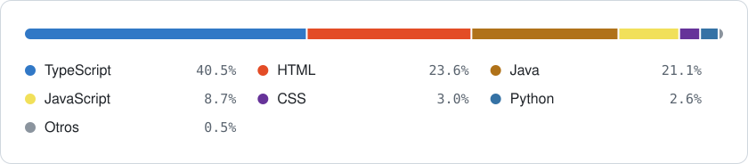

<picture>
  <source media="(prefers-color-scheme: dark)" srcset="assets/header-dark.svg">
  <source media="(prefers-color-scheme: light)" srcset="assets/header-light.svg">
  
</picture>

  
  

## Sobre mí

Estudiante de Ingeniería Informática en la Universidad Católica Andrés Bello (UCAB) y desarrollador full stack. Construyo aplicaciones web completas con TypeScript, desde el modelo de datos hasta la interfaz, y me interesa especialmente el software que resuelve problemas concretos: gestión administrativa, finanzas en contextos multi-moneda y automatización de procesos que hoy se hacen a mano.

Trabajo con prácticas de producción en cada proyecto: integración continua, pruebas automatizadas, entornos reproducibles con Docker, migraciones versionadas y documentación pensada para que otra persona pueda continuar el trabajo.

**Áreas de trabajo**

- **Aplicaciones full stack** con React y Next.js en el cliente, Node.js (Express y NestJS) en el servidor y PostgreSQL como base de datos.
- **Sistemas en tiempo real** con WebSockets (Socket.IO) para colaboración entre varios usuarios.
- **Automatización e inteligencia artificial**: integraciones con la API de Claude (Anthropic) y Gemini, mensajería por WhatsApp, correo IMAP/SMTP y generación de documentos PDF y DOCX.
- **Procesamiento de datos**: ETL, normalización y deduplicación de registros con Python y FastAPI.
- **Escritorio y móvil**: aplicaciones con Electron, Capacitor (Android) y JavaFX con Gluon.

## Tecnologías

<table>
  <tr>
    <td width="170"><b>Lenguajes</b></td>
    <td>
      
      
      
      
      
      
      
      
    </td>
  </tr>
  <tr>
    <td><b>Frontend</b></td>
    <td>
      
      
      
      
      
      
      
      
      
      
      
      
      
      
    </td>
  </tr>
  <tr>
    <td><b>Backend</b></td>
    <td>
      
      
      
      
      
      
      
      
      
      
      
    </td>
  </tr>
  <tr>
    <td><b>Datos</b></td>
    <td>
      
      
      
      
      
      
    </td>
  </tr>
  <tr>
    <td><b>Infraestructura</b></td>
    <td>
      
      
      
      
      
      
      
      
    </td>
  </tr>
  <tr>
    <td><b>Pruebas y calidad</b></td>
    <td>
      
      
      
      
      
      
      
      
    </td>
  </tr>
  <tr>
    <td><b>Escritorio y móvil</b></td>
    <td>
      
      
      
      
      
      
    </td>
  </tr>
  <tr>
    <td><b>IA e integraciones</b></td>
    <td>
      
      
      
      
      
      
      
    </td>
  </tr>
</table>

## Proyectos destacados

<table>
  <tr>
    <td width="50%" valign="top">
      <h3>ALFA</h3>
      
Plataforma web para gestionar anticipos laborales en Venezuela (Art. 144 LOTTT). Flujo completo de solicitud, validación de soportes, aprobación por RRHH, notificaciones e instrucción de pago. Monolito modular con worker de tareas en segundo plano.

      
TypeScript · React · Express · PostgreSQL · pg-boss · MinIO (S3) · Docker Compose · GitHub Actions · Jest · Vitest

      
<a href="https://alfa-oocs.onrender.com">Ver aplicación</a>

    </td>
    <td width="50%" valign="top">
      <h3><a href="https://github.com/mjsanchezr/divide-la-cuenta">Divide la Cuenta</a></h3>
      
Aplicación en tiempo real para dividir la cuenta de una mesa entre hasta 15 personas, en dólares o bolívares con la tasa oficial del BCV actualizada automáticamente, con IVA y servicio opcionales.

      
TypeScript · Node.js · Express · Socket.IO · Vitest · Playwright · Docker · Render

      
<a href="https://divide-la-cuenta.onrender.com">Ver aplicación</a> · <a href="https://github.com/mjsanchezr/divide-la-cuenta">Código</a>

    </td>
  </tr>
  <tr>
    <td width="50%" valign="top">
      <h3><a href="https://github.com/mjsanchezr/AVPG-Press-Brief-Automation-Architecture">Press Brief Automation</a></h3>
      
Sistema que recopila noticias, las cura con IA y genera y envía por correo un resumen de prensa diario en PDF. Incluye un panel de control para revisar y ejecutar cada edición.

      
TypeScript · Node.js · Gemini API · Puppeteer · Nodemailer · React · Google Cloud Run · Vercel

      
<a href="https://avpg-press-brief-automation-archite.vercel.app">Ver panel</a> · <a href="https://github.com/mjsanchezr/AVPG-Press-Brief-Automation-Architecture">Código</a>

    </td>
    <td width="50%" valign="top">
      <h3><a href="https://github.com/mjsanchezr/Ediroo">Ediroo</a></h3>
      
Cliente HTTP sin dependencias construido sobre la Fetch API nativa: timeout configurable, reintentos automáticos, respuestas tipadas e interfaz async/await.

      
TypeScript · Fetch API · Jest

      
<a href="https://github.com/mjsanchezr/Ediroo">Código</a>

    </td>
  </tr>
  <tr>
    <td width="50%" valign="top">
      <h3><a href="https://github.com/mjsanchezr/EY-Agenda">EY Agenda</a></h3>
      
Aplicación de agenda y gestión de tareas con autenticación, recuperación de cuenta, preferencias de usuario y panel de estadísticas.

      
TypeScript · React · Zustand · React Hook Form · Zod · Express · Prisma · JWT · Tailwind CSS

      
<a href="https://github.com/mjsanchezr/EY-Agenda">Código</a>

    </td>
    <td width="50%" valign="top">
      <h3><a href="https://github.com/mjsanchezr/Proyecto-POO-MAZEHUNTER">Maze Hunter</a></h3>
      
Juego de exploración en laberintos generados proceduralmente, con usuarios, estadísticas y niveles de dificultad. Diseñado con principios SOLID y portado a móvil reutilizando el 90 % del código.

      
Java 22 · JavaFX · Gluon Mobile · Gson · JUnit 5 · Maven

      
<a href="https://github.com/mjsanchezr/Proyecto-POO-MAZEHUNTER">Código</a>

    </td>
  </tr>
</table>

<b>Otros proyectos</b>

 

| Proyecto | Descripción | Tecnologías |
| --- | --- | --- |
| [Nexus C.A.](https://github.com/mjsanchezr/Proyecto-SI-NexusC.A) | Frontend de un ERP empresarial tipo intranet. [Demo](https://mjsanchezr.github.io/Proyecto-SI-NexusC.A/) | React, TypeScript, Material UI, Radix UI, Tailwind CSS |
| [Generador de Recibos](https://github.com/mjsanchezr/CARDAMOMO-Y-CELERY-GENERADOR) | Generación de recibos de pago en `.docx` desde el navegador, con lógica de referencia en Java. [Demo](https://mjsanchezr.github.io/CARDAMOMO-Y-CELERY-GENERADOR/) | Java 22, Apache POI, React, Zod, GitHub Actions |
| [Calculadora de Préstamos](https://github.com/mjsanchezr/Ingenier-a-Econ-mica-App) | Evaluación de alternativas de financiamiento por amortización, con exportación a PDF y versión Android. [Demo](https://mjsanchezr.github.io/Ingenier-a-Econ-mica-App/) | React, Tailwind CSS, Chart.js, Capacitor |
| [Malla Curricular](https://github.com/mjsanchezr/MALLA-CURRICULAR) | Malla interactiva de Ingeniería Informática UCAB para seguir el avance de la carrera. [Demo](https://malla-curricular-seven.vercel.app) | JavaScript, HTML, CSS |
| [Waifu Draft](https://github.com/mjsanchezr/waifu-draft) | Juego multijugador de subastas y votaciones en tiempo real para 2 a 4 jugadores. [Demo](https://waifu-draft.onrender.com) | Node.js, Express, Socket.IO, Docker |

## Lenguajes

<picture>
  <source media="(prefers-color-scheme: dark)" srcset="assets/languages-dark.svg">
  <source media="(prefers-color-scheme: light)" srcset="assets/languages-light.svg">
  
</picture>

Calculado sobre el código de todos mis repositorios, públicos y privados.

## Cómo trabajo

- **Calidad automatizada.** Pipelines de CI que validan formato, lint, tipos, pruebas con cobertura, build e imágenes Docker en cada cambio.
- **Pruebas en varios niveles.** Unitarias, de integración contra la API y end-to-end con varios usuarios simultáneos.
- **Entornos reproducibles.** Docker Compose con base de datos, almacenamiento de objetos y correo de pruebas para levantar todo el sistema con un comando.
- **Arquitectura clara.** Monorepos con código compartido entre cliente y servidor, módulos por dominio y migraciones de base de datos versionadas.
- **Documentación útil.** READMEs que explican qué hace el sistema, cómo ejecutarlo y por qué se tomaron las decisiones técnicas.
